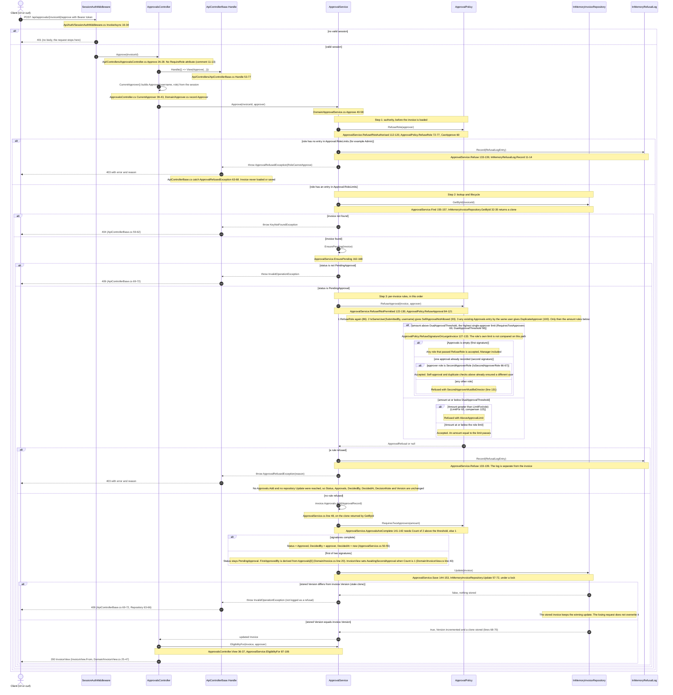

# Approval flow: approve, refuse and second approval

Traced from the code on `feature/approval-limits-by-role` (HEAD `e4f60c8`). Every interaction cites a
file and symbol, with line numbers from that commit. Only behaviour that exists in the code is drawn.
`Reject` is not drawn: it shares the first steps (authority check, then lookup) but has its own rules.

Paths are relative to `backend/src/`. `Api` means `InvoiceApp.Api`, `Domain` means `InvoiceApp.Domain`.

## Dual-approval threshold versus a role's own limit

- A role's own limit is its entry in `Approval:RoleLimits`, read by `ApprovalPolicy.LimitFor` (line 63). It is the most that role may approve alone.
- `DualApprovalThreshold` (`ApprovalPolicy.cs` line 58) is a different value: `_roleLimits.Values.Max()`, the highest single-approver limit across all configured roles. With the shipped configuration that is the Director limit, 500,000.
- `RequiresTwoApprovers(amount)` (line 69) is `amount > DualApprovalThreshold`. Above it, one signature is never enough.
- Below or at it, only the approver's own limit decides (`RefuseApproval` lines 113-120). So a Manager (limit 50,000) is refused with `AboveApprovalLimit` at 200,000.00, while a Director passes.
- Above it, the role's own limit is not compared. The first signature may come from any role that passes `RefuseRole`, including a Manager. The second must come from a different user whose role is `SecondApproverRole` (`IsSecondApproverRole`, line 66-67), otherwise `SecondApproverMustBeDirector`.
- `SecondApproverRole` is configuration. The reason-code name and the UI text say "Director", but the policy compares against the configured role, not a literal.

## How the three scenarios map onto the diagram

| Scenario | Path through the diagram | Seeded example (`Api/InMemoryInvoiceRepository.cs` 16-24) |
|---|---|---|
| Approve (single signature) | Steps 1 to 3 pass, `ApprovalsAreComplete` is true, status becomes `Approved` | INV-1001, 4,250.00, a Manager or Director who is not `demo.admin` |
| Refuse | Any `throw ApprovalRefusedException` branch. `Approvals.Add` and `Update` are never reached | INV-1006, 200,000.00: a Manager attempts to **approve** it and is refused with `AboveApprovalLimit`. This is an approval attempt, not a rejection |
| Second approval | Above the threshold the first signature, by any approving role, leaves the invoice `PendingApproval`. The second must come from a different user whose role is the configured `SecondApproverRole`, then `ApprovalsAreComplete` is true | INV-1009, 900,000.00, already signed by `demo.manager`. A Director other than `demo.manager` completes it. A second Manager is refused with `SecondApproverMustBeDirector` |

## What the code does not do (so the diagram does not draw it)

- `RefuseRole` runs twice on the approve path: once in `ApprovalService.RefuseIfNotAuthorised` (line 112) and once inside `ApprovalPolicy.RefuseApproval` (line 86). The second call is redundant but harmless.
- A refusal is logged and thrown. A stale-version conflict (409) and a missing invoice (404) are **not** written to the refusal log, because only `ApprovalService.Refuse` calls `IRefusalLog.Record`.
- Nothing reads the refusal log: `InMemoryRefusalLog.Entries` (line 16) has no caller in `Api`.
- There is no lock across the lookup and the save, only a version check inside `Update`. If two approvals read the same invoice, whichever `Update` runs first takes the lock, finds the stored `Version` equal to its clone's, increments it and stores its clone. The other `Update` then sees a different stored `Version`, returns `false` and stores nothing, so `Save` throws `InvalidOperationException` and the client gets 409. The stored invoice keeps the winning update. This is not logged as a refusal.
- The UI role label ("needs a Director", `Api/wwwroot/app.js` line 37) is hard-coded and does not come from `SecondApproverRole`.
- Draft invoices cannot be approved: `EnsurePending` returns 409.

## Not verified

- The diagram was traced by reading the code, not by running a request. The revised Mermaid source (with nested alt/else branches) was rendered to SVG with the `mcp-mermaid` server and produced no syntax error. The rendered image was not inspected visually, and no request was run against the app.
- The concurrency path is traced from `InMemoryInvoiceRepository.Update`. No concurrent test was run for this document.
- Line numbers are from `e4f60c8` and will drift as the files change.
